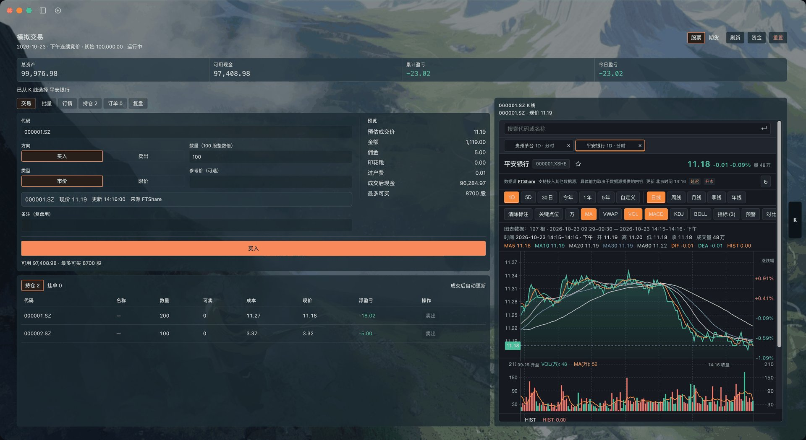
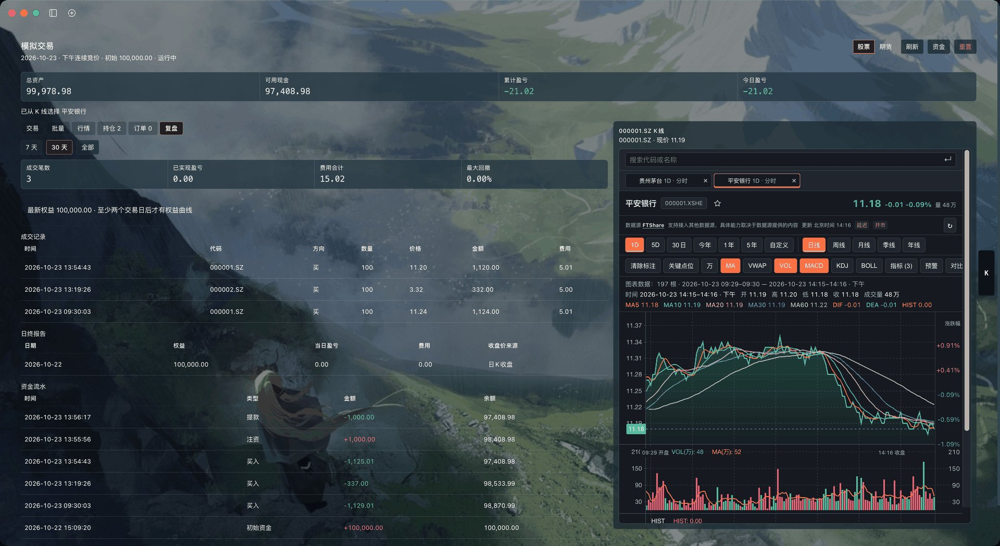
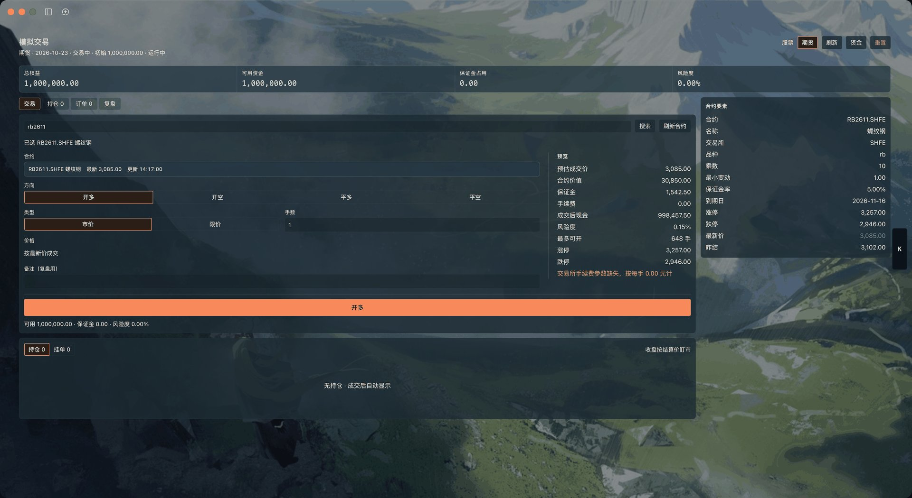

# 模拟交易: dsh-fft-paper-trading

[English](README.md) | 中文

在 DeepSeek Harness 里开一个不用开户的 A 股 / 商品期货账户



> DSH ≥ 0.2.0-rc.2 · 自带行情、交易日历与 K 线 · 账本存本地

## 效果

*复盘页：区间统计、权益曲线、成交记录、日终报告与资金流水。*



*期货页：开多 / 开空 / 平多 / 平空，合约要素、保证金与风险度同屏。*



## 功能

- **下单前，账已经算完**：填代码、方向、数量，预估成交价、佣金、印花税、过户费、成交后现金、最多可买同步刷新，没有「查行情」「预览」两个多余步骤。
- **股票 + 期货，两个独立账户**：首次打开自动开户，A 股 10 万元、商品期货 100 万元模拟资金；期货按手交易、占用保证金、T+0 平仓、日终结算。
- **和 AI 共用同一本账**：对话里说「市价买 200 股 000001」「复盘我这周的交易」，模型直接调用下单与复盘工具，面板和模型撮合的是同一个账户。
- **从 K 线直接开单**：面板里常驻完整 K 线，在图上点选标的，代码自动带进交易页；行情页可翻板块、把常看的标的加入备选。
- **按权重批量建仓**：导入「代码,权重」CSV，填一个预算，一次买入最多 20 只；先看股数、费用、剩余现金，再整批提交。
- **复盘能对账**：权益曲线、最大回撤、成交统计、日终报告、资金流水，收益已剔除出入金。
- **没配 API Key 也能练**：免费档按日 K 收盘价报价，配置 FTShare Key 后切换实时行情。
- **账本在本地**：事件账本落在本机文件，重启 DSH 自动恢复；重置账户前自动备份。

## 安装

```sh
dsh plugin add @dsh-ft/dsh-fft-paper-trading
```

需要 DSH `>= 0.2.0-rc.2`。安装后自带 FTShare 行情、交易日历与 K 线视图，不需要再单独安装数据插件。

- 完整 K 线视图依赖本机 Python 3.10+，首次启动会联网准备运行环境；准备失败不影响下单、持仓和复盘。
- **不要**与 `@dsh-ft/dsh-fft-bundle` 或其他自带 FTShare 数据服务的入口包同时安装：数据服务行会重复，插件管理器里相关项将无法单独开关。

## 上手三步

1. 打开侧栏「模拟交易」，自动开户：股票 10 万元、期货 100 万元；账户头的「资金」可随时注资、提款。
2. 交易页输入代码（如 `000001`），选好方向、数量、市价或限价，预览确认后下单。限价单未穿越会挂单等待，可在「订单」撤单。
3. 「复盘」看权益、回撤与成交，「持仓」看可卖与浮盈亏；随时可以重置账户（重置前自动备份）。

对话里可以直接说：

- 「现在 600519 多少钱？」
- 「用市价买 200 股 000001，备注试试 T+1」
- 「帮我复盘这周的股票交易」

## 行情与 API Key

行情来自 FTShare，分两档：

- **已配置 API Key**：实时行情。
- **未配置 API Key**：免费档，报价取最近一个收盘价（盘中等于上一交易日收盘），分钟线与实时接口不可用；匿名额度有限，用尽后行情暂停，可用手填参考价继续交易，额度恢复后自动恢复（滚动约 24 小时）。

API Key 在 DSH「设置 → 金融终端」中配置，申请地址：<https://ftai.chat/ftshare>。

面板顶栏会显示数据源状态（正常 / 免费 / 无 / 无效）；行情不可用时会说明原因并给出「获取 API Key」或「重试」入口。交易日历降级为「周一至周五」时面板会标注（此时节假日会被当作交易日，T+1、挂单过期与结算按工作日估算）。

## 模拟规则与边界

- **股票**：市价单按最新价一次成交，无部分成交；限价单未穿越才挂单，当日有效。涨停/跌停、停牌、T+1 可卖、佣金/印花税/过户费按 A 股规则模拟；行情缺失时可用参考价下单。
- **期货**：只做商品期货（SHFE / INE / DCE / CZCE / GFEX），只在日盘时段（09:00–11:30、13:30–15:00）接受委托；15:30 按收盘价结算并做风险检查。夜盘、股指/国债期货、交割与移仓不在本期。
- **边界**：不接实盘，不做两融、期权、港美股与策略回测。

## 数据与隐私

- 账本保存在本机 DSH 数据目录（默认 `~/.dsh`）下的 `paper-trading/`（股票与期货各一份），不上传任何服务器。
- 重置账户会先备份到同目录的 `backups/`；账户异常锁定时面板会给出账本路径，可导出后排查。
- 仅用于模拟与研究，不接实盘，不构成投资建议。

## 反馈

遇到 bug 或想加功能，走 GitHub Issues（面板顶栏「反馈」是同一入口）：

- [报告 bug](https://github.com/gigaflw/dsh-fft-paper-trading/issues/new?template=bug_report.yml)
- [功能建议](https://github.com/gigaflw/dsh-fft-paper-trading/issues/new?template=feature_request.yml)

贴日志前先删掉 API Key、账户数据与账本路径。行情额度、Key 与交易日历这类使用问题，先看上面的「行情与 API Key」。

本项目以 [MIT](LICENSE) 许可开源。变更记录见 [CHANGELOG.md](CHANGELOG.md)。
