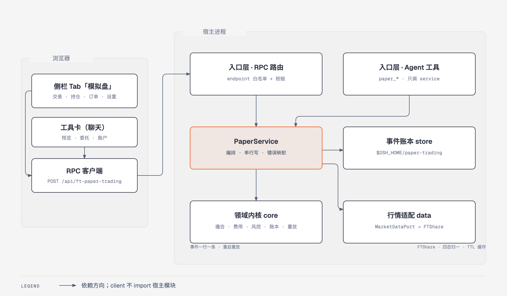
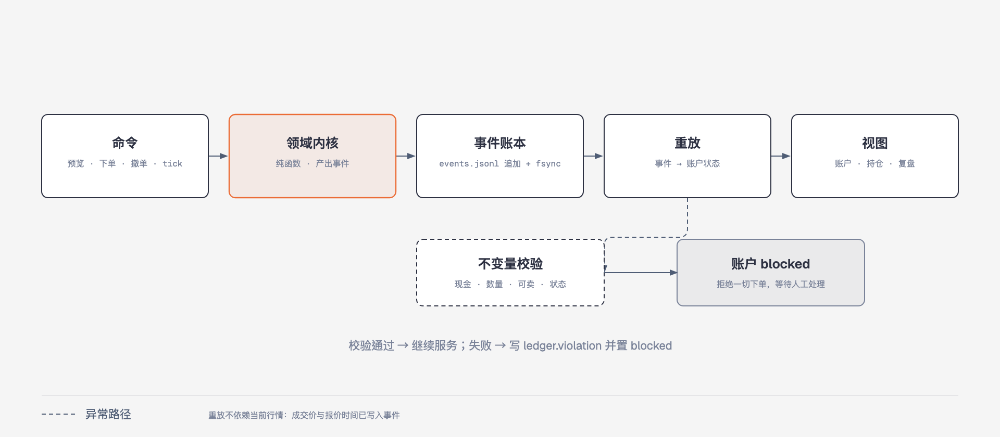
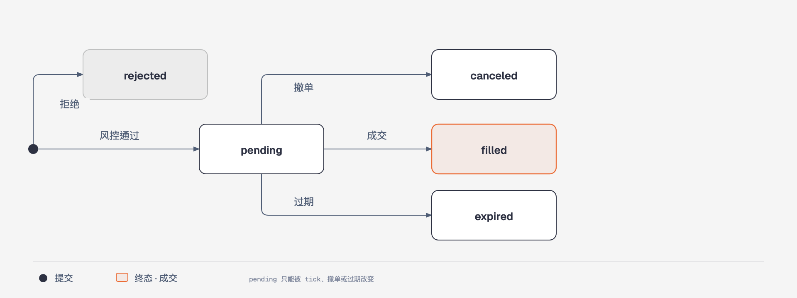

# 模拟盘子插件架构

> 状态：v0.1 已落地；v0.2 P0/P1 已实施（独立仓库 `main`），并完成账本并发/迁移/重置修复、宿主撮合调度与 UI 本地化（§6、§9、§19.7、§19.11），K 线视图由 dsh_kline 的 slot 提供，详见 §19.12。
> 本文写架构、模块边界、账本与扩展方式；v0.1 的范围与验收见 [mvp.md](mvp.md)。
> 配图：图 1–3 见文内。
> 目标包：`@ft/dsh-fft-paper-trading`

## 1 目标与产品边界

**目标**

- 在 DSH 内提供 A 股模拟交易工作台：行情、预览、下单、撤单、持仓、复盘。
- 人和模型共用同一套账本：界面操作与 Agent 工具写入同一个 `PaperService`。
- 账本确定、可审计、可重放；重启不丢状态；异常时失败关闭。

**产品非目标（长期不做）**

- 实盘、券商接入、融资融券、期权、港股美股（期货模拟盘已按 MVP 纳入，见 §20）。
- 策略引擎、因子库、回测平台（本插件只做「模拟执行 + 复盘」，不抢投研舱的活）。
- 多币种、分红送转、除权除息（公司行为只记录假设，不自动处理）。
- 实时行情推送与盘口深度（按需拉取，不建推送通道）。

## 2 与竞品的关系

| 来源 | 借什么 | 落到哪里 |
| --- | --- | --- |
| TradingView | 交易页布局、K 线与交易标记 | 交易页；K 线待做 |
| IG demo | 下单前预览、受理与成交分离 | `order/preview`、订单 `pending` + `tick` |
| openctp | 稳定契约、撮合模式可配、环境分层 | `contract.ts`、`matching.ts`、service 边界 |
| 璇玑 | 事件账本、对账、幂等、失败关闭 | `core/ledger`、`core/replay`、启动校验 |
| 牛牛1号 | 账户卡、收益曲线、交易日历、空态 | 账户头、复盘页、各表空态 |

## 3 已落地能力与后续阶段

| 能力 | 说明 | v0.1 | 后续 |
| --- | --- | --- | --- |
| 左侧栏面板 | `sidebar.panellist` 图标 + `main` 面板 | ● | |
| 交易 / 持仓 / 订单 / 复盘 | 四个页签 | ● | |
| 事件账本 + 重放 + 对账 | JSONL，失败关闭 | ● | |
| 按需 tick + 市价/限价 | 简化撮合，全量成交 | ● | |
| Agent 工具 | 9 个 `paper_*` 工具 | ● | |
| 权益曲线 / 复盘统计 | 纯 SVG + 日终快照 | ● | |
| 交易时段 / 日切 / 收盘开盘快照 | 真实节奏的基础，见 §19.2–19.3 | ○ | v0.2 P0 |
| 行情时间语义 | `marketTs` + `fetchedAt`，见 §19.3 | ○ | v0.2 P0 |
| 搜索 / 自选 / 列表 / 分时 / K 线 | FTShare 有数据源，见 §19.4 | ○ | v0.2 P1 |
| 涨跌停 / 停牌 | 见 §19.5 | ○ | v0.2 P1 |
| 日终 / 隔夜 / 回合 / 资金流水 | 从事件推导，见 §19.6 | ○ | v0.2 P1 |
| 设置页 | 只读 `settings/get` | ○ | v0.3 写入 |
| 工具卡 | 预览 / 委托 / 账户 / 复盘卡 | ○ | v0.3 |
| 止损 / 条件单 / 保证金 / 卖空 / 强平 | 现金账户；两融是产品范围变更 | ○ | 另议 |
| 多账户 / 通知 / 导入导出 | 扩展能力 | ○ | v0.3 |

## 4 总体架构



两个 Cordis 实例、三个平面：

| 平面 | 位置 | 职责 |
| --- | --- | --- |
| 浏览器半 | 宿主 Web UI | 左侧栏面板、四个页签、RPC 调用；不 import 宿主模块、不读文件 |
| 宿主半 | Node 进程 | RPC 路由、应用服务、领域内核、事件账本、行情适配 |
| Agent 半 | 同进程 | 注册 `paper_*` 工具，调用同一个应用服务 |

**技术选择**

- 独立子包 `@ft/dsh-fft-paper-trading`，一行宿主入口 + 浏览器半。
- 宿主 `tsc` 到 `lib/`；浏览器半是手写单文件 JS，构建时原样复制为 `lib/client.js`，带 `window.__ModuleLoader__.load` banner。
- 依赖：`ftshareData`（可选行情）、`tools`（Agent 工具）、`connection`（RPC 路由）、`slots`（UI 位置）。
- 存储：`$DSH_HOME/paper-trading/` 的 JSONL 事件文件，不引数据库。
- 图表：自绘 SVG，不引图表库。

**依赖方向（硬约束）**

```
client(panel) ──HTTP──▶ route ──▶ service ──▶ core
                                    │  │
                                    │  └──▶ MarketDataPort ◀── FTShare adapter
                                    └─────▶ AccountStore   ◀── JSONL repo
agent(tools) ──────────────────────▶ service
core    不 import store / data / service / cordis / fs
store   只 import core 的类型、事件应用与账本校验（不 import service）
data    只 import contract 的类型
service 只 import core 与两个端口，不 import fs / cordis
entry   负责装配与适配器切换；route / tools / data 三条 attach 互不阻塞
client  不 import 宿主任何模块，只走自己的 RPC 路由
```

**装配方式**（`src/index.ts`）

1. 先建 `AccountRepo`（JSONL）与 `PaperService`；行情端口先指向 `UnavailableMarketData`。
2. `ctx.inject(['ftshareData'])` 出现时把端口换成 `FtshareMarketData`，消失时换回不可用实现。
3. `ctx.inject(['connection'])` 与 `ctx.inject(['tools'])` 各自挂路由与工具。
4. 因此没有行情服务时，账户、持仓、订单、复盘、重置仍可用；报价与 tick 以四态失败返回，不会拖垮整行。

## 5 模块拆分

### 5.1 目录（实际结构）

```
dsh-fft-paper-trading/       # 仓库根即包根
  package.json               # exports: . / ./client / ./contract
  cordis.patch.yml           # 一行业务行
  tsconfig.json
  src/
    index.ts                 # 宿主入口：装配 service、切换行情适配器、挂 route / tools
    contract.ts              # 跨平面类型、常量、错误码（无运行时依赖）
    core/                    # 纯领域，禁止 IO
      types.ts               # 状态与事件类型
      money.ts               # 金额（整数分）与价格取整
      fees.ts                # 佣金 / 印花税 / 过户费
      calendar.ts            # 交易日（Asia/Shanghai，工作日兜底）
      matching.ts            # 市价/限价成交判定（M2：last 价、全量）
      risk.ts                # 下单前硬校验与价格估计
      settings.ts            # 持久化配置的规范化/迁移（缺失字段回退默认）
      ledger.ts              # 事件应用与账本不变量
      replay.ts              # 事件 → 状态
      engine.ts              # 命令 → 事件（纯函数）
      views.ts               # 状态 → 视图、预览、复盘统计
    data/
      market-data-port.ts    # 行情端口 + 四态结果
      ftshare-market-data.ts # FTShare 适配（唯一知道接口名的地方）
      unavailable-market-data.ts # 没有行情服务时的兜底端口
    store/
      port.ts                # AccountStore 端口
      paths.ts               # $DSH_HOME 解析与目录
      event-store.ts         # JSONL 追加、fsync、原子替换、读取、坏行隔离、备份
      repo.ts                # 载入 → 去重/重放 → 状态；事务写入；对账；导出
    service/
      paper-service.ts       # 编排：预览/下单/撤单/tick/查询/重置/导出
      scheduler.ts           # 宿主撮合调度器（可注入时钟，随 fiber 释放）
      rpc.ts                 # endpoint 表与 payload 校验
      route.ts               # connection.fetch 路由注册
      errors.ts              # PaperError（错误码 + HTTP 状态）
    agent/
      tools.ts               # 9 个 paper_* 工具定义
      format.ts              # 结果转模型可读摘要
    client/
      index.js               # ModuleLoader 入口 + 面板 + 页签 + 样式（单文件）
  scripts/
    build-client.mjs         # 复制浏览器半到 lib/client.js
    scenario.mjs             # 端到端脚本：下单 → 成交 → 复盘
  tests/                     # 36 个用例，见 §15
```

### 5.2 模块职责与边界

| 模块 | 职责 | 输入 → 输出 | 禁止 | 主要测试 |
| --- | --- | --- | --- | --- |
| `core/money` | 金额用整数分；价格按 0.01 取整 | 数字 → 整数/价格 | 浮点累计、IO | 舍入边界 |
| `core/fees` | 佣金、印花税、过户费 | 金额、方向、配置 → 费用明细 | 读写账户 | 最低佣金、卖出税 |
| `core/calendar` | 交易日、T+1 解锁 | 时间戳 → 交易日 | 网络调用 | 周末 |
| `core/matching` | 市价/限价是否成交、成交价 | 订单、报价 → 成交判定 | 读账本、读文件 | last 价、穿越、无 TTL |
| `core/risk` | 现金、可卖、手数、金额上限、blocked | 状态 + 订单 → 通过/拒绝码 | 网络、日志 | 各类拒绝路径 |
| `core/settings` | 持久化配置合并 `DEFAULT_SETTINGS`，拒绝缺字段/非有限值 | 旧 payload → 完整配置 | 读写账本 | 旧账本迁移 |
| `core/ledger` | 事件类型与不变量 | 状态、事件 → 校验结果 | 持久化 | 现金/数量不变量 |
| `core/replay` | 事件序列 → 状态 | 事件数组 → 状态 | IO、时间 | 幂等、坏序 |
| `core/engine` | 应用命令，产出事件 | 状态 + 命令 → `{events, state}` | IO、随机数 | 全场景 |
| `core/views` | 状态 → 账户/订单/预览/复盘视图 | 状态 → 视图 | 读写文件 | 预览、回撤 |
| `store/port` | 持久化端口的唯一声明 | — | 业务规则 | — |
| `store/repo` | 载入、去重/重放、事务写入、原子替换、对账、价格缓存、备份、导出 | 事件 / 构建函数 → 状态 | 业务规则、创建结算事件 | 坏尾行、并发、修复 |
| `data/port` | 行情端口的唯一声明与四态结果 | — | 账本 | — |
| `data/ftshare` | FTShare 接口映射、代码规范化、四态归一 | 代码列表 → 报价/日 K | 账本 | mock 端口 |
| `service` | 编排、校验、串行、错误映射、重置命令 | RPC/工具入参 → 视图 | 直接算撮合、直接读写文件 | 集成 |
| `service/scheduler` | 宿主侧周期 tick，非重叠、可注入定时器 | 间隔 + tick → 周期调用 | 业务规则、读写账本 | 假时钟周期调用 |
| `service/rpc` | endpoint 白名单、payload 校验 | HTTP → service | 业务逻辑 | 校验失败 |
| `agent/tools` | 工具 schema、摘要、错误转文字 | 模型入参 → service | 直接写文件 | 摘要格式 |
| `client` | 面板、页签、RPC 调用、纯 SVG 图 | RPC → UI | 直接算账、直接取行情 | 入口与样式 |

### 5.3 关键接口

```ts
// data/market-data-port.ts —— 行情只暴露这两件事，失败也走返回值
interface MarketDataPort {
  quotes(symbols: string[]): Promise<QuoteResult>   // { state, quotes, notice? }
  dailyBars(symbol: string, limit: number): Promise<BarsResult>
}

// store/port.ts —— service 只见端口，不见 JSONL
interface AccountStore {
  current(): Promise<AccountState>
  /** 在写队列内用最新状态构建事件并原子追加；并发读不会重复生成日界事件。 */
  transact<T>(build: (state: AccountState) => Transaction<T> | Promise<Transaction<T>>): Promise<TransactionOutcome<T>>
  append(events: readonly LedgerEvent[]): Promise<AccountState>   // 仍强制 seq 连续
  replace(events: readonly LedgerEvent[]): Promise<AccountState>  // 原子替换（重置/压缩）
  markPrices(quotes: readonly Quote[]): Promise<AccountState>     // 非账本事件
  backup(label: string): Promise<boolean>                         // 破坏性操作前备份
  readLedger(): Promise<{ path: string; content: string | null }> // 只读导出
}

// service/paper-service.ts —— 两个传输层共用这一组方法
interface PaperService {
  account(): Promise<AccountView>
  preview(draft: OrderDraft): Promise<PreviewView>
  place(draft: OrderDraft, requestId?: string): Promise<OrderView>
  cancel(orderId: string): Promise<OrderView>
  tick(): Promise<TickView>
  orders(): Promise<OrderView[]>
  trades(): Promise<FillView[]>
  review(period?: '7d' | '30d' | 'all'): Promise<ReviewView>
  quote(symbols: string[]): Promise<QuoteResult>
  bars(symbol: string, limit?: number): Promise<BarsResult>
  settingsView(): Promise<PaperSettings>
  reset(confirm: boolean): Promise<AccountView>
  exportLedger(): Promise<LedgerExport>
}
```

不变量：`core` 不知道端口；`service` 不知道 JSONL；`route` / `agent` 不知道业务规则；`client` 不知道文件与行情接口。

## 6 领域模型与事件账本

### 6.1 状态

```ts
interface AccountState {
  accountId: string
  version: number
  initialCashCents: number      // 分
  cashCents: number             // 分
  settings: PaperSettings       // 开户/重置时写入事件
  positions: Record<string, Position>
  orders: Record<string, Order>
  fills: FillRecord[]
  tradeDate: string             // Asia/Shanghai
  blocked: boolean              // 对账失败后置真
  lastSeq: number
  createdAt: string
  dayEquity: DayPoint[]         // 每个交易日一条收盘快照
}
```

`Position.available` 是「今日可卖」：买入当日为 0，`day.closed` 事件把持仓全部解锁；`enableT1=false` 时买入即可卖。

### 6.2 事件

追加到 `events.jsonl`，一行一个 JSON。所有事件带 `seq / id / ts / type / payload`。

| 事件 | 何时写 | 关键字段 |
| --- | --- | --- |
| `account.opened` | 首次初始化 | 初始资金、配置快照、交易日 |
| `account.reset` | 用户确认重置，或作为压缩后账本的单条 genesis | 配置（默认值合并后）、初始资金、交易日、原因 |
| `order.submitted` | 提交通过风控 | 订单、报价快照 |
| `order.rejected` | 风控或校验拒绝 | 订单、拒绝码 |
| `order.canceled` | 撤单、过期、资金/持仓不足 | 订单 ID、原因、时间 |
| `order.filled` | 撮合成功 | 成交价、数量、费用明细 |
| `day.closed` | 首次跨交易日 tick | 日期、权益、现金、下一交易日 |
| `ledger.violation` | 启动或写入对账失败 | 失败项；账户随即 `blocked`，此后不再追加事件 |
| `ledger.repaired` | 载入时丢弃了重复 seq 事件 | 丢弃条数；随后原子压缩账本 |

未落地的事件（`account.settings`、`risk.blocked`）在 §14.3 里说明，当前不写。

**幂等**：`requestId` 随 `order.submitted` 落账；下单前按 `requestId` 查已有订单，重复请求返回同一订单。
**确定性**：成交价、报价时间、交易日写进事件；重放不依赖当前行情。
**失败关闭**：不变量失败 → 写 `ledger.violation`，`blocked = true`，下单/撤单直接拒绝。

### 6.3 恢复与对账

1. 读 `events.jsonl`，末尾坏行（进程被杀）丢弃并记录 warning。
2. 校验 `seq` 严格递增：同一 seq 且内容相同（忽略易变的 `recordedAt`）视为重复写入，丢弃后补一条 `ledger.repaired` 并把压缩结果原子写回；同一 seq 内容不同则是真损坏，保留原文件并失败关闭。
3. 重放并校验：现金恒等式、持仓数量、可卖 ≤ 持仓、成交数量/价格/金额/费用必须是有限值、已成交订单必须有成交记录。
4. 失败：追加一条 `ledger.violation`，置 `blocked`；原因写进 `AccountState.blockedReason`，界面红条显示「原因 + 账本绝对路径」，可导出账本或重置；工具侧 `paper_account` / `paper_export` 同样给出原因与路径。已锁定的账户不再追加任何事件，避免每 5 秒刷一条。
5. 写入：`transact` 在写队列内用最新状态重建事件，落盘前强制 `event.seq === state.lastSeq + 1`；不连续直接抛错，绝不写坏账本。
6. 重置：先原样备份，再用合并默认值后的配置把账本原子替换为单条 `account.reset`（seq 从 1 开始），内存状态直接替换，不依赖旧账本重放成功。



## 7 撮合、费用与 T+1

| 项 | 规则 |
| --- | --- |
| 报价 | `last` 是唯一可成交价；`bid/ask` 不依赖 |
| 成交价 | 判定所用报价的 `last`（0.01 取整），无滑点 |
| 市价单 | 连续竞价立即全量成交，永远不会挂单 |
| 限价买 | `last ≤ limit` 立即全成，否则挂单，每次 tick 用新报价重判 |
| 限价卖 | `last ≥ limit` 立即全成，否则挂单 |
| 成交量 | 不限量，一次吃满剩余；`fillModel` 默认 `unlimited` |
| 行情门槛 | 只要 `last > 0` 就能成交，没有 TTL |
| 有效期 | 当日有效；15:00 未成交过期 |
| 手数 | 买入 100 的整数倍；卖出不超过可卖，可零股 |
| 费用 | 佣金 `max(金额 × 0.025%, 5 元)`；印花税卖出 0.05%；过户费双向 0.001% |
| T+1 | 买入当日 `available = 0`；下一交易日 `day.closed` 解锁 |
| 涨跌停 | 未做；`risk` 已留 `maxOrderNotionalCents` 单笔上限 |

> 完整的 M2 规则与「什么时候会有挂单」见 §19.5。旧账本（< v3）重放时把 `slippageBps` / `fillModel` 钉成 `0` / `unlimited`。

`tick` 的顺序：跨日 → 写 `day.closed` 并过期挂单 → 刷新持仓最新价 → 逐笔判断限价单 → 资金/持仓不足则撤单并给 notice。

## 8 数据层：FTShare 协议

FTShare 是 MCP 服务，走 StreamableHTTP（JSON-RPC 2.0）；本插件不直接发 MCP，统一走宿主 `ctx.ftshareData.call(interfaceName, args)`。

| 项 | 值 |
| --- | --- |
| 网关 | `https://market.ft.tech/gateway/mcp` |
| 鉴权 | 宿主 FTShare 服务解析 API Key；本插件不读、不展示 |
| 调用 | `callTool({ name, arguments })`，宿主归一成 `{ ok, state, rows, notice? }` |
| 归一 | `available / empty / denied / failed` 四态；`denied ≠ 没有数据` |

默认候选接口（`data/ftshare-market-data.ts`，按顺序探测，`listTools` 缓存可用集合）：

| 用途 | 接口 | 关键入参 |
| --- | --- | --- |
| 实时报价 | `ft_v4_stock_realtime_day_kline` | `symbols[]` |
| 报价/日 K 兜底 | `ft_v1_stock_candlesticks` | `symbol`, `interval_unit=day|Day`, `limit`, `until_ts_millis` |
| 批量日 K | `ft_v2_stock_candlesticks_batch` | `symbols[]`, `interval_unit`, `limit` |

- 代码统一 `600519.SH` / `000001.SZ`；适配器补后缀，也接受已带后缀的写法。
- 字段按候选名归一（`close/last/latest/price/收盘/最新价` 等）；分组 `items` 自动摊平。
- `quote.ts` 是**取数时间**不是行情时间：模拟盘允许收盘后用最后收盘价，不把旧数据判成过期。
- 交易日历接口尚未接入；`core/calendar` 用工作日兜底，节假日会多算一个交易日。
- 行情不可用：禁止开新仓；挂单保持；界面显示四态原因。`UnavailableMarketData` 让「没装行情服务」与「接口失败」同形。

## 9 服务与 RPC

**路由**：`POST /api/ft-paper-trading`，envelope `{ endpoint, payload }` → `{ ok, value | error }`。
**限制**：只接受 POST；请求体 256 KiB 上限；非对象 body 直接 400。
**并发**：同一账户的写命令（transact / append / replace / markPrices / backup）进单一 Promise 队列串行；读接口的时钟推进也走 `transact`，因此并发读只会落一份日界事件。
**错误码**：`ACCOUNT_BLOCKED`、`INVALID_ARGUMENT`、`INVALID_SYMBOL`、`INVALID_QTY`、`INVALID_LOT`、`INSUFFICIENT_CASH`、`INSUFFICIENT_POSITION`、`T1_LOCKED`、`MAX_NOTIONAL`、`ORDER_NOT_FOUND`、`ORDER_NOT_PENDING`、`QUOTE_UNAVAILABLE`、`QUOTE_STALE`。

| endpoint | 作用 | 状态 |
| --- | --- | --- |
| `health` | 路由存活探针 | ● |
| `account/get` / `account/init` | 查账户（首次自动开户） | ● |
| `account/reset` | 重置（必须 `confirm=true`；备份后原子重写为单条 genesis） | ● |
| `account/export` | 只读返回账本原文 + 绝对路径（锁定横幅的「导出账本」） | ● |
| `market/quote` / `market/bars` | 行情与日 K | ● |
| `order/preview` / `order/place` / `order/cancel` | 交易 | ● |
| `tick` | 刷新行情并撮合挂单 | ● |
| `list/orders` / `list/trades` | 列表 | ● |
| `review/get` | 复盘 | ● |
| `settings/get` | 读设置 | ● |
| `settings/update` | 写设置 | ○ v0.2 |

## 10 Agent 工具与工具卡

### 10.1 工具（9 个）

| 工具 | 入参 | 返回 | 卡片 |
| --- | --- | --- | --- |
| `paper_account` | `{ reset?, confirm? }` | 账户摘要（锁定时带原因与账本路径） | 待做 |
| `paper_quote` | `{ symbols }` | 报价表 | 无 |
| `paper_preview` | `{ symbol, side, qty, type, limitPrice?, price? }` | 金额、费用、占用资金、可卖 | 待做 |
| `paper_order` | `{ symbol, side, qty, type, limitPrice?, price?, requestId? }` | 订单状态 | 待做 |
| `paper_cancel` | `{ orderId }` | 订单状态 | 待做 |
| `paper_status` | 无 | 持仓 + 挂单 + 最近成交 | 待做 |
| `paper_tick` | 无 | 成交/过期结果 | 无 |
| `paper_export` | 无 | 账本绝对路径、备份目录、锁定原因（只读） | 无 |
| `paper_review` | `{ period? }` | 曲线与统计 | 待做 |

规则：所有工具只调 `PaperService`；`output.render` 产出中文摘要；`presentationMeta` 尚未添加（工具卡的前置条件）。

工具当前注册在全局行，标准模式也能看到 `paper_*`。若要把它们收进金融模式，按 §14.8 的做法拆 `/agent` 子路径，不要直接搬走整行（浏览器半会丢）。

### 10.2 工具卡（v0.2）

| 卡 | key | 内容 | 动作 |
| --- | --- | --- | --- |
| 预览卡 | `paper_preview` | 代码、方向、数量、限价、金额、费用、现金影响 | 「确认下单」→ `order/place` |
| 委托卡 | `paper_order` / `paper_cancel` | 状态、成交价、费用、时间 | 挂单「撤单」 |
| 账户卡 | `paper_status` | 总资产、现金、持仓摘要、挂单数 | 「打开模拟盘」→ 切到 `main` |
| 复盘卡 | `paper_review` | 权益曲线、回撤、统计 | 「查看复盘」 |

卡片只能渲染与转发 RPC，不能复制业务规则。注册方式见 §14.2。

## 11 客户端

### 11.1 入口

当前用左侧栏图标 + 主面板，不用右侧栏 tab：

| 项 | 做法 |
| --- | --- |
| 注册 | `sidebar.panellist` 放图标（`id: ft-paper-trading`，`order: 30`），`main` 放面板体 |
| 打开 | 用户点左侧栏「模拟盘」图标 |
| 作用域 | 面板是全局视图；账户数据在宿主，与会话无关 |
| 隐藏 | 切走面板即卸载，轮询随组件清理停止 |

右侧栏 tab 方案（`sidebarRightTabs` + `sidebar.right.pane.tab`）保留为候选：它是会话级的，没有会话时打不开，v0.1 不采用。

### 11.2 页面

| 页签 | 内容 |
| --- | --- |
| 交易 | 代码、查行情、方向/类型/数量/限价、参考价、预览面板、买入/卖出 |
| 持仓 | 代码、名称、数量、可卖、成本、现价、浮盈亏；行内「卖出」回填交易页 |
| 订单 | 挂单表（可撤单）、历史表 |
| 复盘 | 7/30/全部区间、成交统计、最大回撤、权益曲线、成交记录 |

账户头：总资产、可用现金、累计盈亏、今日盈亏、刷新、重置（`window.confirm` 二次确认）。
锁定横幅显示失败原因（最后一条 `ledger.violation` 的 `actual`）与账本绝对路径，带「导出账本」（调 `account/export` 下载 JSONL 并复制路径）和「复制路径」；`AccountView` 带 `blockedReason` / `ledgerPath`，所以工具与横幅不必各自猜文件位置。
`data-active="true"` 在 `.pt-tab` / `.pt-seg button` / `.pt-btn` 三处统一有选中态；dsh_kline slot 存在时不渲染内置「日K/分时」假按钮。

**刷新**：页面挂载即拉取 `account/get`、`list/orders`、`list/trades`、`review/get`；每 5 秒在 `document.visibilityState === 'visible'` 时调 `tick` 并静默重载（宿主调度器才是主驱动，见 §19.7）；提交、撤单、重置、手动刷新立即重载，重置后同时刷新日终/流水/回合。
**文案与格式**：时间统一 `Intl.DateTimeFormat('zh-CN', { timeZone: 'Asia/Shanghai' })`；状态、流水类型、撤单原因、错误码都有中文映射，错误码只留在 `title`/详情；非有限数值显示 `—`；代码统一展示 6 位。
**主题**：只用宿主 CSS token；交易橙读共享 `--ft-accent-warm*`，`--pt-accent*` 只是本地别名。
**图表**：`EquityChart` 是纯函数式 SVG（等宽视口、min/max 归一），没有图表库。

### 11.3 UI 基线（B 紧凑版）

已按主仓 `docs/specs/ui/design.md` 接入宿主 UI 基线：

| 项 | 落地 |
| --- | --- |
| 颜色 | 表面/文字/边框/涨跌走 `--dsw-alias-*`；主色读共享品牌层 `--ft-accent-warm*`（亮 `#cf5623` / 暗 `#ff8352`），不回退到 `state-business-primary` |
| 圆角 | `--dsw-radius-xs/sm`，不写 4/6px |
| 字号 | 正文 `--dsh-content-font-size-secondary`；标题 16、说明 12、eyebrow 11 |
| 明暗 | follow：不写主题选择器；品牌层按调色板取值，fallback 用 `light-dark()` |
| 焦点 | 按钮、输入、页签、分段的 `:focus-visible` 统一 2px `--pt-accent` 环 |
| 密度 | 16/18 padding、统计指标带、30px 表格行、120px 图表、下单卡（表单网格 + 同卡预览）+ 底部持仓/挂单卡 |
| 响应 | 容器查询 `paper-panel` 1100/760/520px 与 `paper-main` 640/460px，跟随容器宽度而非窗口 |

验收：本仓不跑主仓的 `ui-audit`，按 `plugin-ui-review` 的隔离渲染流程自检。
视觉对照：[UI 预览（A 舒适 / B 紧凑）](ui-preview.html)。结论取 B。

## 12 设置

v0.1 只读：`settings/get` 返回开户/重置时写进账本的配置；没有设置页，也没有写接口。

| 字段 | 默认 |
| --- | --- |
| `initialCashCents` | 10,000,000（10 万元） |
| `commissionRate` | 0.00025 |
| `minCommissionCents` | 500（5 元） |
| `stampDutyRate` | 0.0005 |
| `transferFeeRate` | 0.00001 |
| `slippageBps` | 0（保留字段，不再生效） |
| `enableT1` | true |
| `quoteTtlSec` | 30（保留字段，不再参与判定） |
| `maxOrderNotionalCents` | 0（关闭） |
| `maxParticipationRate` | 0.10（保留字段，不再参与判定） |
| `fillModel` | `unlimited` |

`account.opened` / `account.reset` 重放时，payload 里的 settings 先经 `core/settings.ts` 的 `normalizeSettings` 与 `DEFAULT_SETTINGS` 合并：缺失字段回退默认值，非有限值也被拒绝。`ledgerVersion < 3` 的旧账本再由 `m2Settings` 钉成 `slippageBps: 0`、`fillModel: 'unlimited'`（旧版本没有设置入口），见 §19.5。

写设置的做法见 §14.3：新增 `account.settings` 事件，随账本重放；`contract.ts` 的 `DEFAULT_SETTINGS` 只给新账户默认值。
FTShare API Key 由全局设置服务解析，本插件不读、不展示、不修改。

## 13 存储

```
$DSH_HOME/paper-trading/
  default/
    events.jsonl              # 追加写，一行一事件，0600
    backups/
      events-<ts>.jsonl       # 每次重置前原样复制一份
      events-repair-<ts>.jsonl # 载入时修复重复 seq 前的原文件
```

- `DSH_HOME` 优先，`~/.dsh` 兜底；目录 700、文件 600。
- 每次 append 后 `fsync`；写失败直接报错，不吞。
- 坏尾行读取时丢弃并 warn；重复 seq 先按内容去重修复，冲突或非有限成交才触发 `ledger.violation`。
- 重置与压缩都用「同目录临时文件 + fsync + rename」原子替换，失败不留半截文件。
- `meta.json`、备份保留最近 5 份、按年轮转都还没做（§17）。

## 14 扩展点（按改动落点）

### 14.1 新页签 / 新图

都在 `src/client/index.js` 的 `Dashboard` 里加一个页签 + 一个渲染函数；数据走已有 RPC：

- 日 K：`rpc('market/bars', { symbol, limit })`，返回 `{ state, bars, notice }`；图表按 `EquityChart` 的纯 SVG 写法，数据 → path 的纯函数单独抽出来便于测试。
- 复盘已有，加字段只动 `core/views.ts` 的 `toReview` 与客户端展示。

单文件客户端是 v0.1 的取舍（与投研舱一致）：文件超过约 1000 行或需要多文件复用再引打包器（tsdown/esbuild），不要手写拼接。客户端改完必须跑 `pnpm build`，`lib/client.js` 随提交走。

### 14.2 工具卡

1. 客户端注册 `ctx.slots.inject('tool.call.toolview', ...)`，`key` 用工具名。
2. 工具补 `output.presentationMeta(args, value)`，返回 `{ kind: 'paper.order', orderId }` 之类的展示元数据。
3. 卡片动作只调 RPC（`order/place`、`order/cancel`、切 `main` 面板），不复制业务规则。

### 14.3 设置写入

1. `contract.ts` 加 `account.settings` 事件与视图字段（如需）。
2. `core/types.ts` 加事件类型，`core/ledger.ts` 的 `applyEvent` 处理它。
3. `core/engine.ts` 加纯函数命令（如 `updateSettings`）返回事件；`service` 暴露方法并走 `repo.append`。
4. `rpc.ts` 加 `settings/update` 与 payload 校验。
5. 客户端加设置页签或设置卡；保存后重新拉 `account/get`。

### 14.4 新行情源

实现 `MarketDataPort`（两类方法，四态结果），在 `src/index.ts` 替换 `FtshareMarketData`。代码规范化、字段归一、超时都在适配器里，`service` 不动。缺数据时返回 `failed` 而不是抛错。

### 14.5 新存储 / 多账户

实现 `AccountStore`（`current / append / markPrices / backup`）。多账户时每个 `accountId` 一个 repo + 一个 service，路由按 `accountId` 选择；注意同一账户只能有一个写者（repo 的 Promise 队列保证进程内串行，跨进程没有锁）。

### 14.6 撮合 / 风控规则

先改 `core/matching.ts` 或 `core/risk.ts` 的纯函数，补 `tests/core.test.mjs`，再让 `engine` 产出对应事件。成交价必须写进事件，保证重放确定性。

### 14.7 涨跌停

`risk` 加价格上下限校验（用 `prevClose` + 板块规则），`matching` 加「涨跌停价不成交」判定；两者都不读文件、不联网，用现有报价字段即可。

### 14.8 把工具收进金融模式（preset）

当前 `paper_*` 是全局行。要做成「只在金融模式出现」：

1. 全局行继续提供浏览器半与 RPC 路由，并把 service `ctx.provide('paperTrading', service)`。
2. 新增 `./agent` 子路径导出，只注册工具，`inject: ['paperTrading']`。
3. 在 bundle 仓库（主仓）的 `cordis.patch.yml` 的 `preset-ft-finance.plugins` 里加一行 `@ft/dsh-fft-paper-trading/agent`。
4. 不要给 preset 行加裸包名，否则浏览器半会挂到 preset 的 detached 子树、在模块扫描里消失（主仓 `tests/patch.test.mjs` 挡住）。

## 15 测试策略

当前 42 个用例（`pnpm test`，构建后跑 `node --test`）：

| 文件 | 覆盖 |
| --- | --- |
| `core.test.mjs` | 费用（最低佣金/印花税）、撮合（last 价/穿越/无 TTL）、风控（手数/现金/T+1）、引擎成交与重放、限价挂单与 tick 成交、收盘过期、旧账本 M2 迁移、fillQty 满额 |
| `service.test.mjs` | 买入 → 隔日解锁 → 卖出 → 复盘 → 重置（含备份）、幂等、无行情时的降级、预览价=行情价=成交价、并发 tick 不重复成交、市价单永不挂单 |
| `rpc.test.mjs` | envelope、preview/place、未知 endpoint |
| `store.test.mjs` | JSONL 追加、坏尾行隔离 |
| `adapter.test.mjs` | 代码规范化、分组摊平、日 K 排序 |
| `client.test.mjs` | ModuleLoader 入口、面板/图标注册、整页宽度与容器断点、无「查行情」按钮、防抖预览与成交回报 |
| `wiring.test.mjs` | 没有 `ftshareData` 时路由与 8 个工具仍挂载，账户可读、行情四态失败，宿主调度器随行启动 |
| `ledger.test.mjs` | 并发读只写一份日界事件、seq 不变量、重复 seq 修复/冲突、旧 settings 迁移、重置健壮性、日 K 补 `prevClose` |
| `scheduler.test.mjs` | 假时钟周期调用、非重叠、start/stop 幂等、异常转 warning |
| `brand.test.mjs` | 浏览器半读的 `--ft-*` 兜底值与品牌契约一致（本仓不依赖 settings 包） |

尚未覆盖：路由 405/413、工具卡（待做）；P2 挂单冻结资金未实现（见 §19.11）。

## 16 演进路线

| 版本 | 内容 |
| --- | --- |
| v0.1（已落地） | 左侧栏面板（交易/持仓/订单/复盘）+ 8 个工具 + 事件账本 + 权益曲线 |
| v0.2（P0+P1，见 §19） | 交易时段/日切/收盘开盘快照、行情时间语义、M2 撮合、搜索/自选/列表/分时/K 线、涨跌停/停牌、日终/隔夜/回合/资金流水 |
| v0.3 | 工具卡、设置写入、止损/条件单、多账户、通知、导入导出 |
| 另议 | 保证金 / 卖空 / 强平（两融模拟，属产品范围变更） |

> 一揽子配股 v1（CSV 代码 + 权重、仅买入）的规格见 [basket.md](specs/basket.md)，尚未实现。

## 17 风险与待验证

| 风险 | 影响 | 处理 |
| --- | --- | --- |
| FTShare 不返回 bid/ask（已实测） | 成交价只能用 last，不能模拟 spread | 适配器不填买卖价；撮合固定用 last（§19.5） |
| 每次 MCP 调用新建会话 | 首包延迟偏高 | 报价缓存（v0.2）；tick 合并请求 |
| 无 L1/L2 盘口（已实测） | 只能做「最新价全量」撮合 | 不显示盘口、不伪造深度；M2 不设成交量上限（§19.5） |
| 列表排序不可靠（已实测） | 无法直接做全市场涨幅榜 | `order_by` 只验证到升序；P1 不做涨幅榜，不依赖未确认的 `filter` 语法 |
| 收盘后探针看不到盘中效果 | 分钟 bar 在盘中是部分完成还是含当前分钟未知 | 交易时段内复验一次；`marketTs` 只展示，不设 TTL（§19.5） |
| 宿主休眠/退出错过收盘 | 快照延迟、T+1 解锁晚 | 宿主 `PaperScheduler` 周期 `advanceTo(now)` 幂等补算；离线不补成交（§19.2、§19.7） |
| 涨跌停/ST 比例随规则变化 | 拒单错误 | 板块比例集中配置，实现前按交易所现行规则复核 |
| 撮合过于简化 | 与真实成交有差距 | 产品明确选 M2：last 价全量成交，不为真实感额外请求分钟量（§19.5） |
| 开源许可 | 复制 LGPL/GPL 代码会污染许可 | 只借架构与规则，不复制代码（§19.10） |
| 公司行为不处理 | 长期成本失真 | README 写明；v0.3 另议 |
| 客户端单文件 | 页面增多后难维护 | 先按页签拆函数；过 1000 行再引打包器 |
| 工具在全局模式可见 | 标准模式出现模拟盘工具 | 按 §14.8 收进 preset |

## 18 关键决策

| # | 决策 | 理由 |
| --- | --- | --- |
| D1 | 事件账本用 JSONL | 数据量小、可 diff、确定性重放 |
| D2 | 宿主定时器驱动 tick，前端轮询只作补充 | 面板关掉也要撮合与结算；`advanceTo` 幂等，漏拍可补算 |
| D3 | 不做部分成交与止损单 | 规则简单可验证；M2 一次吃满剩余 |
| D4 | 单账户、单币种 | 范围控制 |
| D5 | 自绘 SVG 图表 | 避免引图表库与跨插件耦合 |
| D6 | 独立子包 | 边界清楚，可独立发版 |
| D7 | 浏览器只走自己的 RPC 路由 | 两平面隔离 |
| D8 | 设置属于模拟盘 | 不挤进全局设置卡 |
| D9 | 数据只走 `ctx.ftshareData` | 凭据与四态归一一条路径 |
| D10 | 术语定 `paper trading`：工具前缀 `paper_`、包名、路由、数据目录四处同名 | 业界标准词，特指「真实行情 + 虚拟资金」；`sim` 会把回测/仿真撮合也算进来 |
| D11 | v0.1 用左侧栏面板，不用右侧栏 tab | tab 是会话级，没有会话打不开；面板全局可用 |
| D12 | 行情端口可缺省（`UnavailableMarketData`） | 行情服务是可选依赖，账本与面板不能因它缺失而消失 |
| D13 | 存储与行情都以端口注入 service | 换后端/换数据源不动业务；测试用假端口即可 |
| D14 | 重置也走 `append` 与对账 | 破坏性操作同样受不变量保护；备份先于写入 |
| D15 | 交易日历来自 FTShare，时段表内置，集合竞价单独建模 | 节假日会变、时段是规则；日历库都不建模竞价（§19.2） |
| D16 | 行情用 `marketTs` + `fetchedAt` 两个时间戳 | 展示用行情时间；成交由时段门禁把关，M2 不设 TTL（§19.5） |
| D17 | 收盘 15:00 写快照，交易日次日 09:30 切换 | 自然日 00:00 切日会半夜解锁 T+1、写错快照（§19.2） |
| D18 | 离线期间不补成交，只补收盘快照 | 补成交会造出用户没看见的成交；保守假设可解释（§19.2） |
| D19 | 只做最新价全量成交（M2） | 没有买卖价与深度数据，不伪造盘口；产品明确不为真实感加戏（§19.5） |
| D20 | 日终/隔夜/回合/流水全部从事件推导 | 避免第二套账本，报表与持仓现金天然一致（§19.6） |
| D21 | 不引入 Nautilus/Lean 运行时 | LGPL/Apache 之外还有语言与数据适配成本；只借模型边界（§19.10） |

## 19 v0.2：P0/P1 改造设计

> 本节是增量设计，§1–18 仍是 v0.1 现状。目标：把「账本正确」升级为「市场节奏正确」——时间不加速、非交易时段不成交、收盘用收盘价、次日开盘才解锁 T+1。
> 外部事实：[开源模拟交易实现](thirdparty/sim-trading-open-source.md)；选型分析：[P0/P1 选型](investigation/sim-trading-p0-p1.md)。

### 19.1 目标与范围

**P0（先做，故事的前提）**

- 交易时段、午休、节假日、集合竞价、收盘/开盘时点；
- 行情时间语义（`marketTs` vs `fetchedAt`）；
- 15:00 收盘快照、次日 09:30 开盘快照与 T+1 解锁；
- 盘后只预埋、市价拒绝；离线跨日不补成交。

**P1（随后，故事的体验）**

- 搜索/自选/全市场列表/分时/K 线；
- 涨跌停、停牌；
- 日终/隔夜/跳空/回合统计/资金流水；
- 委托备注，用于复盘「为什么选这个标的」。

**明确不做**：保证金/卖空/强平、L2 深度、止损/条件单、工具卡、设置写入、多账户；时间加速永远不做。

### 19.2 交易时段与日切（P0）

**日历与时段分离**

```ts
interface TradingCalendarPort {
  isTradingDay(date: string): Promise<boolean>
  nextTradingDay(date: string): Promise<string>
  tradingDays(from: string, to: string): Promise<string[]>
  /** 数据来源，用于界面提示与排障。 */
  readonly source: 'ftshare' | 'fallback'
}
```

- 适配器 `FtshareTradingCalendar` 调 `ft_v1_time_trading_calendar` 与 `ft_v1_time_get_nth_trade_date`，按区间缓存 1 天；
- FTShare 日历的入参与返回都是 **YYYYMMDD 整数**（实测 `trade_dates` 为整数数组）；适配器在边界转换，内部统一 `YYYY-MM-DD`；
- 取不到时回退「周一至周五」并标 `source: 'fallback'`，界面显示日历降级，而不是静默当成准确；
- 时段表是交易所规则，集中在 `core/session.ts`，不散落在 service/UI：

| 阶段 | 时间（Asia/Shanghai） | 可提交 | 可连续撮合 | 说明 |
| --- | --- | --- | --- | --- |
| `pre_open` | 09:15–09:30 | 限价 | 否 | 集合竞价；09:20/09:25 的撤单差异先按可撤简化，落地前按交易所规则复核 |
| `continuous_am` | 09:30–11:30 | 市价/限价 | 是 | |
| `lunch` | 11:30–13:00 | 限价预埋 | 否 | 市价拒绝 |
| `continuous_pm` | 13:00–14:57 | 市价/限价 | 是 | |
| `auction_close` | 14:57–15:00 | 不接受 | 否 | MVP 不模拟收盘竞价撮合，避免接受后 15:00 过期 |
| `closed` | 15:00–次日 09:15 | 限价预埋 | 否 | 市价拒绝；当日未成交单已在 15:00 过期，新单为次日预埋 |

**订单门禁**

- `place` 先调 `advanceTo(now)`，再取 `sessionAt(now)`：
  - 市价只在 `continuous_am` / `continuous_pm` 接受；其余阶段返回 `SESSION_CLOSED` 或 `AUCTION_ONLY`（A 股竞价阶段实际也接受市价申报，这里先按拒绝简化，落地前复核）；
  - 限价在任意阶段可接受：撮合阶段进 `pending`，非撮合阶段进 `queued`，都写 `order.submitted`；
  - 竞价阶段的限价单不连续撮合，开盘/收盘按开盘价/收盘价判定是否成交；
  - 当日有效：15:00 对 `tradeDate == 当日` 的未成交单写 `order.canceled(reason=expired)`，不再等次日首次 tick；
  - 收盘后（`closed`）的限价单是**为下一交易日预埋**：订单记 `tradeDate = nextTradingDay`、状态 `queued`，不参与当日 15:00 过期，次日 09:15 起归入新交易日。
- 撤单任意阶段可用；已成交/已过期返回 `ORDER_NOT_PENDING`。
- 新错误码：`SESSION_CLOSED`、`AUCTION_ONLY`、`PRICE_LIMIT`、`SUSPENDED`、`INSUFFICIENT_LIQUIDITY`。

**日切与补算**

- `tradeDate` 在 **09:15 进入 pre_open** 时切换（集合竞价订单属于新交易日），不在自然日 00:00；
- 15:00 写 `day.closed`（收盘价、权益、费用、持仓、下一交易日）；09:15 写 `day.pre_opened`（只切交易日、不解锁）；09:30 写 `day.opened`（开盘价、昨收、跳空、T+1 解锁）；
- 所有 service 方法入口统一 `advanceTo(now)`：按交易日顺序补齐遗漏的收盘快照；宿主定时器只负责及时触发，不承担唯一职责；
- **离线期间不补成交**：宿主不在线时挂单保持原状态，恢复后从当前时段继续；只补收盘快照与 T+1。理由见选型文档 §5；
- 定时器由 `service/scheduler.ts` 的 `PaperScheduler` 承担：默认 5 秒一轮、不重叠、`start/stop` 幂等，`index.ts` 用 `ctx.effect` 随 fiber 释放；定时器与间隔可注入，测试用假时钟驱动。前端 5 秒轮询保留为面板可见时的补充触发，不再是唯一驱动。

### 19.3 行情时间与收盘/开盘（P0）

**两个时间戳**

```ts
interface Quote {
  symbol: string
  name?: string
  last: number
  /** 实测 FTShare 不返回买一/卖一；字段保留兼容，适配器不填，撮合不得依赖。 */
  bid?: number
  ask?: number
  prevClose?: number
  /** 行情时间：bar/trade 的时间；M2 只用于展示，不参与成交判定。 */
  marketTs: string | null
  /** 取数时间：只用于展示延迟与排障。 */
  fetchedAt: string
  source?: string
}
```

- 适配器从分钟/日 K 的 bar 时间取 `marketTs`；`ft_v4_stock_realtime_day_kline` 用当日 bar 的结束时间；
- `ft_v4_stock_realtime_minute_kline` 的 `ts_millis` 是 bar 的**收盘时间**，`ts_millis_open` 是开盘时间；实测最后一根为 15:00，首根 09:30，没有 09:15–09:25 竞价 bar；
- M2 没有行情 TTL：`last > 0` 即可成交，时段仍由 `sessionPhaseAt` 把关；`marketTs` 只用于展示；
- 收盘后估值可以用最后收盘价，但成交判定必须 `canMatch=false`。

**收盘价与开盘价**

- 收盘价：优先当日日 K 的 `close`（16:00 后通常可取）；取不到时用最后连续竞价报价并标 `closeSource: 'last'`；
- 开盘价：当日第一根分钟 K 的开盘价（或 09:30 后第一条报价）；取不到时标 `openSource: 'missing'`，不猜测；
- 快照事件：

```ts
type DayOpened = {
  date: string
  openPrices: Record<string, number>
  prevClose: Record<string, number>
  gaps: Record<string, number>       // (open - prevClose) / prevClose
  t1Unlocked: boolean
  recordedAt: string
}
type DayClosed = {
  date: string
  closePrices: Record<string, number>
  equityCents: number
  cashCents: number
  feesCents: number
  positions: PositionSnapshot[]
  nextTradeDate: string
  closeSource: 'daily' | 'last'
  recordedAt: string
}
```

- 事件 `ts` 写边界时间（09:30 / 15:00），`payload.recordedAt` 写实际补算时间；两者分开，重放与展示都不混淆；
- 账本版本 `PAPER_LEDGER_VERSION` 从 1 升到 2（`day.opened`），M2 再升到 3；新账户在 `account.opened` 的 payload 写当前版本，旧日志缺这个字段按 1 处理；
- v1 日志没有 `day.opened`，重放时按旧语义在 `day.closed` 解锁；v2 才按开盘解锁，保证老账户可读。

### 19.4 行情面（P1）

FTShare 目录里已有的数据源（见主仓 `packages/dsh-fft-ftshare/catalog.json`）：

| 能力 | 接口 | 实测/用途 |
| --- | --- | --- |
| 搜索 | `ft_v1_search` | 返回 `symbol/name/board/close/change/change_rate`；无买卖价 |
| 全市场 A 股实时 | `ft_v1_daec_stocks` | 5909 只，`page_size` 实测 500 可用；含 `st/status/prev_close/board/volume` |
| 代码与名称全集 | `ft_v1_stock_list` | 5575 条，代码 + 名称 |
| 板块筛选 | `ft_v2_stock_list_filter` | `board` 枚举 `star/chi_next/bjse/xshg/xshe/main`；`page_size` 500 |
| 停牌 | `ft_v1_suspension_list` | 当日全量停牌，含类型/原因/复牌时间 |
| 涨跌停池 | `ft_v1_limit_list` | `up/down/up_break`，含首次封板时间、封单金额、开板次数、涨跌停价 |
| 实时 1 分钟 K | `ft_v4_stock_realtime_minute_kline` | 实测 241 根（09:30–11:30、13:00–15:00），无竞价 bar；volume 为股数 |
| 历史分钟 | `ft_v2_stock_minutes` / `_batch` | 多日分时 |
| 分时价格/均价 | `ft_v4_daec_history_prices` | 分时图；返回 price/avg_price/volume/turnover |
| 日/周/月 K | `ft_v1_stock_candlesticks` | 收盘后含当日 bar；volume 为股数 |
| 封单金额 | `ft_v2_stock_minute_seal` | 判断封死涨停（可选；当日 600519 无封单返回空） |

**已实测的数据缺口**

- **没有买一/卖一，也没有 L2/L3 盘口**：搜索、全市场列表、实时日 K、实时分钟 K 都只给最新价/OHLC；界面不显示盘口，撮合不能用 spread。
- `ft_v1_daec_stocks` 的 `order_by=change_rate` 只验证到升序（跌幅方向）；`DESC` 会把退市/空值排在最前，不能直接当「涨幅榜」。
- `filter` 的可用语法未确认（`st = false`、`status=Normal` 均返回 0 行），P1 不依赖它做筛选。
- `ft_v1_daec_stocks.ts_millis` 是快照更新时间（实测 16:29），不是收盘时间；不能当 `marketTs`。

**端口增量**

```ts
interface MarketDataPort {
  quotes(symbols: string[]): Promise<QuoteResult>
  dailyBars(symbol: string, limit: number): Promise<BarsResult>
  minuteBars(symbol: string, date?: string): Promise<BarsResult>
  search(query: string, limit?: number): Promise<SymbolHit[]>
  marketList(filter?: { board?: string; page?: number; pageSize?: number }): Promise<MarketListResult>
}

interface MarketListResult {
  state: DataState
  /** 当前页行情；字段与 Quote 一致。 */
  quotes: Quote[]
  page: number
  total?: number
  notice?: string
}
```

- `SymbolHit { symbol, name, exchange }`；
- 搜索/列表/分钟都要按 `DataState` 四态归一，缺数据不抛错；
- **没有 L1/L2**：界面只展示最新价、涨跌幅、成交量额，不展示盘口；撮合只用最新价，不伪造 spread；
- 自选不是账本：`$DSH_HOME/paper-trading/watchlist.json`，600 权限、原子写；交易账户重置不影响自选。

**客户端**

- 新增「行情」页签：搜索框、自选表、涨停/跌停/停牌池、全市场分页列表；
- 不做全市场「涨幅榜」：上游 `order_by` 不能可靠降序；要做得本地全量拉取（约 12 次 500 条）并缓存，P1 先不做，避免用错误排序误导用户；
- 点击标的同时刷新报价并回填交易页；
- 分时与日 K 复用纯 SVG；分时用 `ft_v4_stock_realtime_minute_kline`，日 K 用 `ft_v1_stock_candlesticks`；
- 报价只随交易页输入变化（300ms 防抖）由 `order/preview` 带回，页面不单独轮询报价；
- 客户端文件预计超过 1000 行：按 settings 的 tsdown 方案拆 `src/client/` 多文件，不手写拼接。

### 19.5 撮合模型 M2（不做更真实）

**规则顺序（固定，便于测试与解释）**

1. 时段门禁（§19.2）→ 2. 停牌 → 3. 涨跌停 → 4. 手数/资金/持仓 → 5. 成交价与数量 → 6. 费用与 T+1。

**成交价**

- 成交价 = 本次判定所用报价的 `last`，按 0.01 取整，**无滑点**；
- `slippageBps` 字段保留兼容，读取与撮合都忽略，默认 0；
- FTShare 没有买卖价，不能用 spread 定价；`bid/ask` 不参与任何判定。

**数量**

- 一次成交吃满剩余数量，**永不产生 `partially_filled`**（类型保留，只为重放旧账本）；
- `fillModel` 默认 `unlimited`；不再按分钟成交量设上限，place/tick 都不请求分钟接口；
- `maxParticipationRate` 保留兼容，不再参与计算；
- 成交 ID 确定性：`fill-<orderId>-<n>`，同一订单顺序固定，重放一致。

**行情门槛**

- 没有 TTL：只要 `last > 0` 就能成交；时段仍由 `sessionPhaseAt` 把关，非交易时段不撮合；
- `quoteTtlSec` 保留兼容，不再参与判定；
- 预览、行情行、成交价必须是同一次判定里的同一次报价：`order/preview` 把本次抓到的 `quote` 一起返回，面板直接用它渲染行情行。
- 预览的「预估成交价」= 这张单在本次报价下能成交的价：市价单取 `last`；限价单取 `min(限价, last)`（买）/ `max(限价, last)`（卖）。穿越时它就等于 `last`（与成交价一致），未穿越时它等于限价（买入的上限成本 / 卖出的下限收入），并给出「现价 X 未到限价 Y，委托将挂单等待」的提示；资金校验与「最多可买」也按这个价算，挂着的 10.00 买单不会被按 11.29 收费。

**什么时候会有挂单（就这两种）**

| 时段 | 市价单 | 限价单 |
| --- | --- | --- |
| 连续竞价（09:30–11:30、13:00–14:57） | 立即全成 | 已穿越（买 `last ≤ limit`、卖 `last ≥ limit`）立即全成；未穿越挂单，每次 tick（宿主 5s）用新报价重判，穿越即全成 |
| 非连续竞价（09:15–09:30、午休、14:57–15:00、收盘后） | 拒绝（市价不可提交） | 委托进 `queued`，进入连续竞价后的第一次判定按上一条处理 |
| 收盘时仍未成交 | — | 当日过期（`expired`） |

因此只有「限价单价格没到」和「非连续竞价时段」会产生挂单；**市价单在任何时段都不会挂单**。

**账本迁移**

- `PAPER_LEDGER_VERSION` = 3：v2 引入 `day.opened`，v3 钉住 M2；
- 重放 `ledgerVersion < 3` 的 `account.opened` 时强制 `slippageBps: 0`、`fillModel: 'unlimited'`；旧版本没有设置入口，用户没设过这些值；
- `account.reset` 不带版本号，重放时同样钉住；
- 新账本默认就是 0 / unlimited。

**涨跌停**

| 板块 | 比例（相对昨收） | 备注 |
| --- | --- | --- |
| 主板 | ±10% | |
| ST / *ST | ±5% | 按名称/标记识别，落地前复核 |
| 创业板 / 科创板 | ±20% | 注册制 |
| 北交所 | ±30% | |
| 新股/无昨收 | 不设限 | 标记 `unknown` |

实测板块值：`ft_v2_stock_list_filter` 返回 `board=sh/sz/sh_star/sz_chi_next/bj`；`ft_v1_daec_stocks` 返回 `XsheMain/XshgMain` 等。映射：`sh`/`sz` 且非 ST → 10%，`sh_star`/`sz_chi_next` → 20%，`bj` → 30%，ST/*ST → 5%。`st` 字段在退市股上可能为 false，必须同时看 `status=Normal` 与名称前缀。

- 价格按 0.01 取整；买单高于涨停价、卖单低于跌停价 → `PRICE_LIMIT`；
- 涨停价买入、跌停价卖出默认不成交（封死假设）；可选接 `ft_v2_stock_minute_seal` 判断封单，未接时按 `high == low == 涨停/跌停` 判一字板；
- 跌停价买入、涨停价卖出允许（对手方有流动性）；
- `prevClose` 缺失时用上一交易日日 K 收盘；两者都没有则不设涨跌停，标 `priceLimitSource: 'unknown'`；
- 当日已触板的股票可直接用 `ft_v1_limit_list` 的 `limit_up_price/limit_down_price`（实测字段）校准；封死判断用 `limit_up_seal_value`、开板次数用 `limit_up_break_count`，比 `high == low` 更可靠。

**停牌**

- 优先用 `ft_v1_suspension_list`（实测当日返回全量停牌，含全天/临停/原因）；拿不到列表时才看日 K 成交量 0 或 `ft_v1_daec_stocks.status == 'Suspended'`；完全取不到数据是 `QUOTE_UNAVAILABLE`，不能混同；
- 停牌期间拒单；持仓按最后收盘价估值，不产生成交。

**状态机**

```
提交 ──时段/风控拒绝──▶ rejected
  ├─连续竞价 市价 / 已穿越限价──▶ filled
  ├─连续竞价 未穿越限价──▶ pending ──tick 穿越──▶ filled
  │                          └──撤单/收盘──▶ canceled / expired
  └─非连续时段限价──▶ queued ──进入连续竞价──▶ pending
```

### 19.6 复盘、流水与报告（P1）

- **资金流水**：从 `account.opened/reset` + `order.filled` 推导逐笔余额（时间、类型、金额、余额、关联订单），不新增第二套账本；
- **日终报告**：日期、收盘权益、当日盈亏、费用、T+1 可卖、持仓、跳空；端点 `review/daily`；
- **隔夜/跳空**：开盘价 vs 昨收，逐持仓计算隔夜盈亏；
- **回合统计**：平均成本法（与账本一致），按标的聚合已平仓数量、成本、收入、盈亏、持仓天数；胜率、盈亏比、平均持仓时长；端点 `review/roundtrips`；
- **备注**：`OrderDraft.note?: string`（≤120 字），随 `order.submitted` 落账，复盘页可见；
- **导出**：`review/export { dataset: 'daily'|'cash'|'roundtrips', format: 'csv' }`，P1 可后置；
- UI：复盘页加「日终 / 隔夜 / 回合 / 流水」分区；交易 ticket 加备注。

### 19.7 模块、端口与调度增量

```
src/core/session.ts          # 阶段、门禁、下一边界（纯函数）
src/core/price-limit.ts      # 板块比例、涨跌停价
src/core/fills.ts            # 成交序列与费用（M2 全量，无部分成交）
src/core/reports.ts          # 日终、隔夜、回合
src/data/trading-calendar-port.ts
src/data/ftshare-trading-calendar.ts
src/store/watchlist.ts       # UI 偏好，不入账本
src/service/scheduler.ts     # 宿主定时器，周期调用 service.tick（advanceTo 幂等补算）
```

- `PaperService` 只新增 `advanceTo`/`marketStatus`/`search`/`marketList`/`minuteBars`/`dailyReport`/`roundtrips`/`cashFlow` 等编排方法；成交规则仍留在 `core`；
- `MarketClock` 依赖 `TradingCalendarPort` + 定时器，不依赖行情；行情缺失时仍能推进日切；
- 所有时间来自注入的 `now()`；测试用假时钟覆盖午休、收盘、跨节假日。

### 19.8 契约、RPC、工具、UI 增量

**契约**

- `SessionPhase`、`MarketStatus { phase, tradeDate, canSubmit, canMatch, nextBoundary, reason }`；
- `Quote.marketTs/fetchedAt`；`OrderStatus` 增加 `queued` / `partially_filled`；
- `OrderView` 增加 `filledQty/remainingQty/avgFillPrice/note`；
- `PriceLimit { upper, lower, ratio, source }`；
- `DayReport`、`CashFlowEntry`、`RoundTrip`、`SymbolHit`；
- 事件：新增 `day.opened`；`order.partially_filled` 只用于重放旧账本，新撮合不再写；扩展 `day.closed`、`order.submitted`（阶段、备注）、`order.filled`（`fillModel`）；
- 账本版本 3（M2），回放兼容 v1/v2。

**RPC**

| endpoint | 作用 |
| --- | --- |
| `market/status` | 当前阶段、下一开/收盘、是否可交易 |
| `market/search` | 代码/名称搜索 |
| `market/list` | 全市场分页列表（代码/涨跌幅，按页加载） |
| `market/bars`（`interval`） | 日 K / 当日/历史分钟 K |
| `watchlist/get` / `watchlist/set` | 自选读写 |
| `review/daily` | 日终报告 |
| `review/roundtrips` | 回合统计 |
| `cash/flow` | 资金流水 |

`market/bars` 增加 `interval: 'day' | 'minute'` 与可选 `date`，默认 `day`，保持旧调用兼容；不再单列分钟 K 端点。

**工具**

- 新增 `paper_market`：`{ action: 'status'|'search'|'list', query?, board?, page? }`；
- `paper_quote` 输出阶段与行情时间；盘后明确「不可成交」；
- `paper_status` 加日终摘要；`paper_review` 加 `daily` / `roundtrips`；
- 下单工具透传 `note`。

**客户端**

- 全宽工作台：移除 1080px 阅读上限；桌面为「左工作区 + 右 K 线栏」，右栏 `clamp(380px, 38%, 760px)`；
- 两列 `align-items:stretch`：K 线栏决定行高，左列拉伸到同一条底边；页签内容区 `flex:1`，交易页底部常驻「持仓 / 挂单」卡（`flex:1`，表内滚动），左下角不再留白；
- K 线**常驻**所有 tab，`position:sticky` 跟随页面滚动；窄于 1100px 时右栏折到 tabs 上方、不再 sticky；
- K 线高度 `clamp(420px, 100vh - 250px, 720px)`；未安装 dsh_kline 时回退内置 SVG；
- 交易页只有一张下单卡：表单按两列网格排（代码/数量、方向/类型、价格、备注），费用预览是同卡右列；提交按钮整宽，禁用原因与可用/最多可买在卡底；左工作区窄于 760px 时预览折到表单下方、再窄则表单改单列；
- 行情页只保留搜索/列表；K 线不再属于某个 tab；会话状态徽标、下单按钮禁用原因、ticket 备注；
- 复盘页日终/隔夜/回合/流水；
- 文件拆分方案见 §19.4。

### 19.9 测试与验收

**已核对（2026-10-21 FTShare 实调）**

| 项 | 实测结果 | 对设计的影响 |
| --- | --- | --- |
| 交易日历 | `market/start_date/end_date` 必须是 **YYYYMMDD 整数**；返回 `trade_dates` 整数数组；2026-10-01～07 被正确跳过 | 适配器做整数 ↔ ISO 日期转换，内部仍用 `YYYY-MM-DD` |
| 搜索 | `ft_v1_search` 返回 `symbol/name/board/close/change/change_rate`，**无买卖价** | 搜索只做选择，不提供盘口 |
| 全市场列表 | 5909 只；`page_size=500` 可用；含 `st/status/prev_close/board/volume`；`ts_millis` 是快照时间（16:29） | 列表分页加载；`marketTs` 不能取它 |
| 列表排序 | `order_by=change_rate` 为升序；`DESC` 把退市/空值排在最前；`filter` 未确认 | 不做全市场涨幅榜，不依赖 `filter` |
| 代码全集 | `ft_v1_stock_list` 5575 条 | 代码校验/离线搜索兜底 |
| 板块筛选 | `ft_v2_stock_list_filter` 的 `board`：`star/chi_next/bjse/xshg/xshe/main`；返回 `board=sh/sz/sh_star/sz_chi_next/bj` | 涨跌停比例按 board 映射 |
| 停牌 | `ft_v1_suspension_list` 当日返回全量停牌（全天/临停/原因） | 停牌判定优先用它，不看成交量猜 |
| 涨跌停池 | `ft_v1_limit_list` 支持 `up/down/up_break`，含涨跌停价、封单金额、开板时间 | 触板/封死判定用它校准 |
| 实时分钟 K | 241 根（09:30–11:30、13:00–15:00）；`ts_millis` 是 bar 收盘时间；无 09:15–09:25 竞价 bar；volume 为股数；收盘后返回全日 | 首根 09:30 可用；`marketTs` 取 `ts_millis`；成交量只用于展示 |
| 日 K | 收盘后含当日 bar（close 1309.69） | 收盘快照取日 K close |
| 分时 | `ft_v4_daec_history_prices` 241 条，含 `price/avg_price/volume/turnover` | 分时图直接用 |
| 市场快照 | `ft_v1_daec_market_snapshot` 返回 `status=closed` 与涨跌分布 | 可作辅助展示，不作为时段依据 |
| 定时器 | DSH 有 cordis timer：`ctx.timeout/ctx.interval` 随 fiber 回收 | 用 `ctx.timeout` 排边界，不用原生轮询 |
| 盘口 | 搜索/列表/实时 K 均无买一/卖一，无 L1/L2 | 界面与撮合都只基于最新价/OHLC |

**仍未验证**：交易时段内分钟 bar 是否含当前未完成分钟、MCP 速率限制、涨跌停/ST 比例的交易所现行文本、DSH 休眠/唤醒时 timer 的实际行为。前两项在 P1 开工前补测，后两项按规则复核与 `advanceTo` 兜底。

**单元**

- 时段：节假日、午休、集合竞价、收盘边界、下一交易日；
- 行情：`marketTs` 只展示；`last ≤ 0` 不可成交；盘后受时段门禁不可成交；
- 涨跌停：主板/ST/创业板/北交所、舍入、越界拒单、一字板；
- M2：市价 `last` 全成、限价穿越即全成、未穿越挂单、收盘过期、无 TTL、旧账本迁移成 0/unlimited；
- 日切：15:00 快照、09:30 T+1、跳空、跨多日补算、离线不补成交；
- 报表：日终/隔夜/回合/流水与持仓现金对账。

**集成**

- 用假时钟 + 假日历 + 固定行情重放用户故事 8 步；
- 重启续跑；无行情降级；断网/服务缺失；账本 v1/v2 → v3 回放。

**验收（对应用户故事）**

1. 15:30 市价单拒绝，限价单 `queued`；次日 09:30 按开盘价判定；
2. 15:00 快照用收盘价；T+1 次日 09:30 才解锁；
3. 离线跨日不产生成交，只补快照；
4. 限价未穿越才挂单，收盘过期；市价单从不挂单；
5. 涨停买入/跌停卖出/停牌有明确拒绝码；
6. 搜索、自选、分时、日 K 可用；界面不显示盘口（数据源没有），只显示最新价；
7. 日终、隔夜、回合、流水与账本一致，可导出。

### 19.10 参考与取舍

**产品层**（五产品调研：[`docs/investigation/sim-trading-competitors.html`](investigation/sim-trading-competitors.html)）：

| 能力 | 借谁 | 说明 |
| --- | --- | --- |
| 交易日历 / 账户总览 / 复盘空态 | 牛牛1号（Apache-2.0） | 交易日历、收益曲线、操作日志、空态/加载态 |
| 账本纪律 / 对账 / 幂等 / 失败关闭 | 璇玑（无 License） | 只学设计，不复制代码 |
| 图表 / 交易标记 / 下单 ticket | TradingView | K 线、指标、画线、盘口、交易标记 |
| 预览 / 受理与成交分离 | IG demo | v0.1 已落地 |
| 撮合契约 / 仿真环境分层 | openctp（BSD-3） | 接口契约与双模式；A 股现货规则自己实现 |

**实现机制层**（补充参考，事实见 [`docs/thirdparty/sim-trading-open-source.md`](thirdparty/sim-trading-open-source.md)）：

| 参考 | 借什么 | 不借 / 注意 | 许可 |
| --- | --- | --- | --- |
| QuantConnect Lean | 数据驱动的交易时段/节假日/提前收盘、下一开收盘；成交前先判交易所开关门；限价只在穿越时成交、跳空按开盘价；行情过旧等待 | 不引入 .NET 运行时；其股票 fill model 的深度部分成交仍是 TODO | Apache-2.0 |
| NautilusTrader | 沙盒 = 实时数据 + 模拟执行；撮合引擎与成交模型分层；L1 剩余差一档；事件溯源 seq + 快照；现金账户全额结算 | 不复制源码（LGPL）；不引入 Rust/Python 内核 | LGPL-3.0 |
| freqtrade dry-run | 真实行情 + 模拟钱包、订单不下发；市价按订单簿量 + 滑点上限；限价超时；离线不补成交 | 不复制代码（GPL）；不照搬加密现货规则 | GPL-3.0 |
| exchange_calendars | XSHG 09:30–11:30 / 13:00–15:00 与预计算节假日，可作为对照测试 | 不引入 Python；它不建模集合竞价 | Apache-2.0 |
| openctp | 接口契约分层、仿真/实盘环境切换 | CTP 期货规则不适用 A 股现货 | 见原调研 |

**本仓自己实现**：时段门禁、日终/开盘快照、涨跌停、M2 全量成交、日终/隔夜/回合/流水。理由是产品参考已经给了目标，实现机制再借开源项目的模型边界；不引运行时、数据源已固定、账本必须可重放。

### 19.12 K 线视图接入（dsh_kline slot）

paper-trading **不自己画完整 K 线**，只声明一个子槽位；dsh_kline 安装时把可嵌入视图注册进来：

```text
paper-trading main 注册
  children: { 'paperTrading.kline': { kind: 'single', scope: 'root' } }
        │
        ├─ dsh_kline 未安装：paper-trading 渲染内置 SVG 简图（日 K / 分时）
        └─ dsh_kline 安装：ctx.slots.inject('paperTrading.kline', register(PaperKlinePanel))
```

- 槽位名 `paperTrading.kline`，props `{ symbol, onIdentity(symbol, name) }`；
- `PaperKlinePanel` 复用 `StandaloneKlineApp`，数据、指标、画线仍由 dsh_kline 负责；
- 在 K 线内选标的会通过 `onIdentity` 回填交易 ticket 并刷新简图；paper-trading 不直接 import dsh_kline 的运行时值（DSH 禁止跨特性包值导入）；
- dsh_kline 侧改动在本地分支 `feat/paper-trading-panel`，发布新版本后把 bundle 的 `@ftshare-lab/dsh-kline` pin 前移即可；未发布时功能自动降级为内置简图。

### 19.11 不做 / 推迟

- 保证金、卖空、强平（现金账户；两融是产品范围变更）；
- L2/L3 盘口与逐档撮合（无数据源）；
- 止损/条件单/算法单（P2）；
- 工具卡、设置写入（v0.3，与「真实节奏」无关）；
- **挂单冻结资金（原 P2）**：现状是「可用现金不减、多笔委托可叠加，成交时才因资金不足静默撤单」。要修干净需要在订单上引入每笔委托的资金/持仓预留，并在 submit / 撤单 / 过期 / 重放上对称维护，再把「可用/冻结」暴露到 `AccountView` 与持仓表；这属于账本字段变更，不适合混进本轮修复批次。结论：**本轮不做**，列为下一批独立改造，届时同时补不变量与重放用例。
- 多账户、分红送转、通知（v0.3）；
- 时间加速/快进（永远不做）。

## 20 期货 MVP 与一揽子（已实现）

> 需求与取舍：[futures-spec.md](specs/futures-spec.md)、[futures-mvp.md](specs/futures-mvp.md)、[basket.md](specs/basket.md)。
> 本节只写落地后的模块边界、账本语义与集成点，不重复需求。

### 20.1 边界

- **期货独立账户**：账本 `$DSH_HOME/paper-trading/futures/events.jsonl`，版本 `futures-v1`，与股票账本互不读取；账户头切换 `股票 | 期货`。
- 只做商品期货（SHFE/INE/DCE/CZCE/GFEX）、日盘（09:00–11:30，含 10:15–10:30 小节休息；13:30–15:00）、T+0；无夜盘、无 CFFEX/NIB、无交割/移仓/组合保证金。
- 一揽子只做买入、市价、连续竞价，CSV 两列（代码 + 权重），一次事务批量下单。

### 20.2 模块

```
src/futures-contract.ts          # 跨平面类型/设置/RPC 形状（无运行时依赖）
src/core/futures/                # 纯领域：session / money / fees / margin / engine / ledger / replay / views
src/core/basket.ts               # CSV 解析 + 权重配股纯函数
src/store/futures-repo.ts        # JSONL 事务账本（EventStore 已泛型化，股票共用）
src/data/futures-market-data-port.ts
src/data/futures-market-data.ts  # FTShare 适配器（三套后缀归一、按日缓存、≤20 分批）
src/service/futures-service.ts   # 编排：账本/行情/日历/时钟；无 IO
src/service/futures-rpc.ts       # futures/* 端点与 payload 校验
src/agent/futures-tools.ts       # 8 个 futures_* 工具
src/client/index.js              # 账户切换 + StockDashboard / FuturesDashboard + BasketTab
```

依赖方向沿用 §4：`core` 不 import 任何外层；`service` 只依赖 core 与端口；`client` 只走 RPC。

### 20.3 账本与资金

- 事件：`account.opened / account.reset / order.submitted / order.filled / order.rejected / order.canceled / position.forced_liquidation / day.opened / day.closed / ledger.violation / ledger.repaired`；重放逐字段一致，任一对账不变量失败即锁户。
- **保证金按开仓价冻结**并从现金扣除；权益 = 现金 + 保证金 + 按最新价（收盘后按收盘价）的浮盈亏。现金只由成交、费用、保证金冻结/释放改变，不随行情波动，重放天然一致。
- 多空持仓分行、不互冲；平今按持仓 `todayQty` 用 `offset_today_fee` 拆费，其余用 `trading_fee`；手续费/保证金率快照冻结在持仓上。
- 结算单点 **15:30**：一次事务里按收盘价盯市 → 风险度 ≥ 100% 强平 → 距到期 ≤3 交易日禁开/到期强平 → 挂单过期 → 写 `day.closed` → 推进交易日。无收盘价时跳过按陈旧价的强平（警告），到期强平仍执行。
- 限价单不预占保证金；撮合前复核，资金不足则撤单；收盘未成交过期。
- 业务拒单（保证金不足/临近交割/无成交/涨跌停/缺参数）写 `order.rejected` 并返回 ok 包络；时段关闭、锁户、参数非法返回 error 包络。开仓失败关闭（行情/涨跌停/保证金率缺一不可），平仓允许手填参考价。

### 20.4 行情适配

- `FuturesMarketDataPort` 五组数据：contracts / quotes / limits / settle / closes；四态 `ok|stale|denied|failed`，失败整批不返回半份。
- 三套后缀（行情 `.SHFE`、基础数据 `.SHF/.CZC`、涨跌停/结算 `.SHF/.ZCE/.CFX`）只在适配器归一；合约索引排除 NIB/CFFEX/缺乘数或 tick，按交易日缓存（内存 + `contracts.json`）。
- 涨跌停优先 `ft_limit`；分钟回退时 `source='minutes'`，风控允许 ±1 tick 容差。`m_ratio`/`long_margin_rate`/`margin_info` 统一成小数。
- 无 `ftshareData` 时装配 `UnavailableFuturesMarketData`，账本、持仓、历史、重置仍可用；首页明确「期货行情不可用」。

### 20.5 集成

- `src/index.ts` 装配 futures repo/service/scheduler/route/tools；RPC 按前缀分发：`futures/*` → futures handler，其余回落股票 handler，浏览器半只用一条 `/api/ft-paper-trading`。
- `PaperScheduler` 同时驱动股票与期货 `tick`，面板关闭也照常结算；`ctx.inject(['ftshareData'])` 出现时同时替换股票与期货适配器，dispose 时各自复位。
- 期货 8 个工具与 `paper_*` 平行、不复用：资金/手数/开平语义不混。

### 20.6 客户端

- 壳 `Dashboard` 只管账户切换；`StockDashboard` 原样保留（等高两列、单张下单卡、底部 book、K 线右栏），`FuturesDashboard` 独立状态、RPC 与 5s 轮询。
- 期货：交易/持仓/订单/复盘四页签（无行情页、无 K 线）；搜索选合约，右栏合约要素卡；方向 `开多/开空/平多/平空`；预览显示保证金、手续费、风险度、最多可开、平仓可平、涨跌停；底部常驻「持仓/挂单」复用 `.pt-trade-book`。
- 一揽子：交易页签之后的独立页签，CSV `file.text()` → 宿主解析/配股 → 预览表 9 列 + 合计/剩余现金 → 生成 `batchId` 一次提交；切走即清空。

### 20.7 测试

- 单元/服务/RPC/wiring：`pnpm test`（108 条，股票 42 条无回归）。
- 离线端到端（真服务 + 真账本 + 假行情）：`tests/e2e/offline-basket.mjs`、`tests/e2e/futures-offline.mjs`。
- 浏览器端到端（真 React DOM + 真 bundle + 假 RPC，不启 DSH）：`tests/e2e/ui-panel.mjs`，设置 `UI_SHOTS=<dir>` 可截图；方法见 [tests/e2e/README.md](../tests/e2e/README.md)。
- 应用内验收：同步 profile → ⌘Q 重开后按 [futures-mvp.md](specs/futures-mvp.md) §4 走查。

### 20.8 已知取舍

- D9「当日 volume>0」缺数据源：分钟行的 volume 是分钟量，不能当日成交量，适配器不映射；volume 未知时按 `last>0` 视为有成交（不加 warning，避免每次预览都刷），未来合约索引补日成交量即可收紧。
- 实盘分钟行只给裸小写代码 + `exchange`，适配器按 `<code>.<EXCHANGE>` 归组并保留裸码兜底；`ft_v1_futures_ft_limit` 的 SHFE 整表分页会报 "missing pre-settlement price"，失败时按 `ts_code` 逐合约精确查、再退分钟（±1 tick 容差）。
- 按成交额计费的品种：SHFE 按千分比、DCE/GFEX 按万分比折算（RB 0.1‰、铁矿 1‱ 实测合理）；折算后超过 0.05% 的异常上游值不猜（INE 会把平今元/手填进费率字段），回退默认手续费并提示「费率单位异常」。有每手费时永远优先每手费；DCE/GFEX 仍待首个交易日用单手成交额复核。
- 日结算不把浮盈亏划入现金、不重写持仓成本；权益按收盘价重算。要更贴近实盘结算需单独一批改动账本语义。
- 重启后 `account()` 不取行情，marks 用上次落盘价，首个 5s tick 前显示的浮盈可能滞后；账本与重放不受影响。
- 合约索引/涨跌停表失败没有负缓存：掉线期间每次预览会重试上游；后续加短 TTL 负缓存。
- 期货 `closes` 逐合约串行；持仓很多时结算会变慢，后续可换批量 K 线接口。
- 一揽子不做卖出/再平衡/限价/盘后预埋/Agent 工具，逐步扩；客户端在预览成功时冻结 `batchId`，重试复用同一批。
- 股票/期货账户切换会卸载另一半仪表盘，表单、搜索和选中合约按设计重置；需要保留草稿时再单独做持久化。
- 预览请求本身失败（error 包络）不阻止提交，交由下单时的服务端校验兜底；业务拒单与 RPC 错误信息优先显示宿主给的完整中文原因。
- 窄屏（≤1100px）K 线/合约要素栏移到页签上方，交易表单会落在首屏下方；这是响应式取舍，宽屏保持左右分栏。

## 附录 A：错误码与状态机

> M2 状态机见 §19.5；`partially_filled` 只为重放旧账本保留。

订单状态：`queued → pending → filled`，以及 `canceled / rejected / expired`；只有 `pending` 能被 `tick` 改变，`queued` 在进入连续竞价后释放。

```
提交 ──风控/时段拒绝──▶ rejected
  ├─连续竞价 市价 / 已穿越限价──▶ filled
  ├─连续竞价 未穿越限价──▶ pending ──tick 穿越──▶ filled
  │                          └──撤单/收盘──▶ canceled / expired
  └─非连续时段限价──▶ queued ──进入连续竞价──▶ pending
```



## 附录 B：与宿主既有能力的复用

| 能力 | 复用方式 |
| --- | --- |
| 行情与日 K | `ctx.ftshareData.call()`（MCP StreamableHTTP） |
| 面板位置 | 原生 `sidebar.panellist` + `main` 槽位 |
| 工具卡（待做） | `tool.call.toolview` 槽位 |
| 主题 | 宿主 CSS token + `--ft-*` 品牌层 |
| 数据目录 | `$DSH_HOME`（`DSH_HOME` 优先，`~/.dsh` 兜底） |
